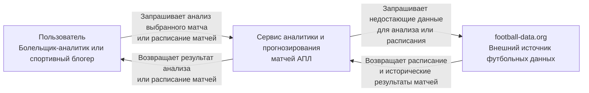
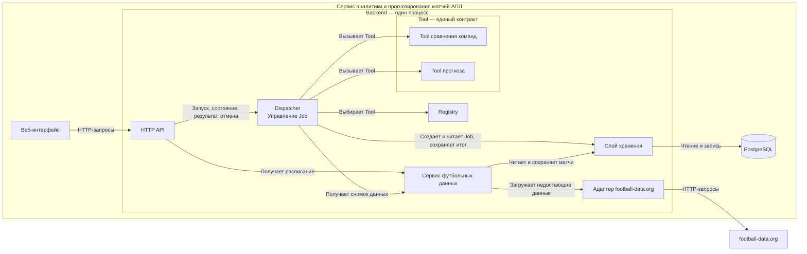

# Архитектура сервиса аналитики и прогнозирования матчей АПЛ

## Контекстная схема

**Смысл стрелок:** стрелки показывают вызовы и ответы при взаимодействии пользователя,
сервиса и внешней системы. Направление к сервису или внешнему API обозначает запрос,
обратное направление — ответ. Зависимости кода на этой схеме не показаны.

Сервис показан целиком: веб-интерфейс, backend, БД, Dispatcher и Job находятся внутри
его границ. Их устройство раскрыто на компонентной схеме ниже.

### Сценарии взаимодействия

1. **Анализ выбранного матча.** Пользователь запускает анализ. Dispatcher создаёт
   и сохраняет Job, организует её выполнение. Сервис использует имеющиеся футбольные данные,
   а при их отсутствии или устаревании запрашивает данные у football-data.org.
   Результат сохраняется в БД и становится доступен пользователю.
2. **Расписание матчей.** Пользователь запрашивает расписание. Если оно есть в БД
   и актуально, сервис возвращает сохранённые данные. При отсутствии или устаревании
   данных сервис запрашивает расписание у football-data.org, сохраняет его в БД
   и возвращает пользователю.

## Компонентная схема

HTTP API и Dispatcher работают в одном backend-процессе. Dispatcher принимает
команды, создаёт Job и управляет их фоновым выполнением.

**Смысл стрелок:** вызовы во время выполнения: `A → B` — A вызывает операцию B.
Ответы и ошибки возвращаются обратно и отдельно не показаны. Dispatcher принимает
команду запуска без ожидания расчёта в HTTP-запросе. Зависимости кода не показаны.

### Ответственность и скрываемые детали

| Компонент | Ответственность | Что скрывает от соседей |
|---|---|---|
| Веб-интерфейс | Выбор матча, запуск анализа, просмотр и отмена Job | Экраны и состояние интерфейса |
| HTTP API | Проверка формата запросов, передача команд, формирование ответов | Маршруты, сериализацию и HTTP-коды |
| Dispatcher | Управление Job, идемпотентность и выбор Tool | Координацию выполнения, отмены и ожидания квоты |
| Registry | Поиск Tool по операции | Регистрацию и создание исполнителей |
| Tool сравнения команд | Расчёт статистики по подготовленному снимку через общий контракт Tool | Формулы расчёта |
| Tool прогноза | Расчёт вероятностей по подготовленному снимку через общий контракт Tool | Статистический метод |
| Сервис футбольных данных | Расписание и снимки данных, проверка актуальности, загрузка | Выбор между БД и источником, подготовку выборки |
| Слой хранения | Операции с Job, результатами, ключами и футбольными данными | SQL, таблицы и транзакции |
| Адаптер football-data.org | Получение и проверка внешних данных, повторы, сообщение о квоте | URL, авторизацию и HTTP-формат; заменяется fake в тестах |
| PostgreSQL | Постоянное хранение данных | Физическое хранение и индексы |

### Основные потоки

1. **Анализ.** HTTP API проверяет формат запроса и передаёт команду Dispatcher.
   Тот проверяет допустимость операции и идемпотентность. Для нового ключа
   сохраняет Job в `created`, возвращает её id и выполняет в фоне.
2. **Выполнение Job.** Dispatcher выбирает Tool через Registry, получает снимок
   у сервиса футбольных данных и вызывает Tool с параметрами и снимком.
   Tool не обращается к БД или источнику. Итог и конечное состояние Job
   сохраняются атомарно через слой хранения.
3. **Ожидание и отмена.** Dispatcher управляет `waiting_quota` и отменой.
   Перед обращениями к источнику, включая повторы адаптера, проверяется признак
   отмены из контекста выполнения; перед сохранением итога его проверяет Dispatcher.
4. **Расписание.** HTTP API вызывает сервис футбольных данных: актуальная БД →
   ответ; отсутствующие или устаревшие данные → адаптер → БД → ответ. При сбое
   допустимо устаревшее расписание с отметкой времени по требованиям. Job не создаётся.

### Идемпотентность

Dispatcher сохраняет связь ключа идемпотентности с Job в БД: тот же ключ
и параметры возвращают прежнюю Job, другие параметры дают конфликт.
Новый ключ создаёт новую Job, даже если параметры анализа совпадают.

### Что такое снимок данных

Снимок — подготовленный и зафиксированный на время расчёта набор входных данных:
сведения о выбранном матче и командах, момент отсечения и исторические матчи
со счётом и датами, отобранные до этого момента. Например, при анализе матча
15 ноября в выборку входят только матчи, сыгранные до его начала.

Сервис футбольных данных собирает этот набор из БД, при необходимости загружая
недостающие данные через адаптер. Dispatcher передаёт снимок выбранному Tool.
Tool считает по этому набору без обращений к БД или внешнему API; обновление
данных в БД во время расчёта не меняет уже переданный снимок.
