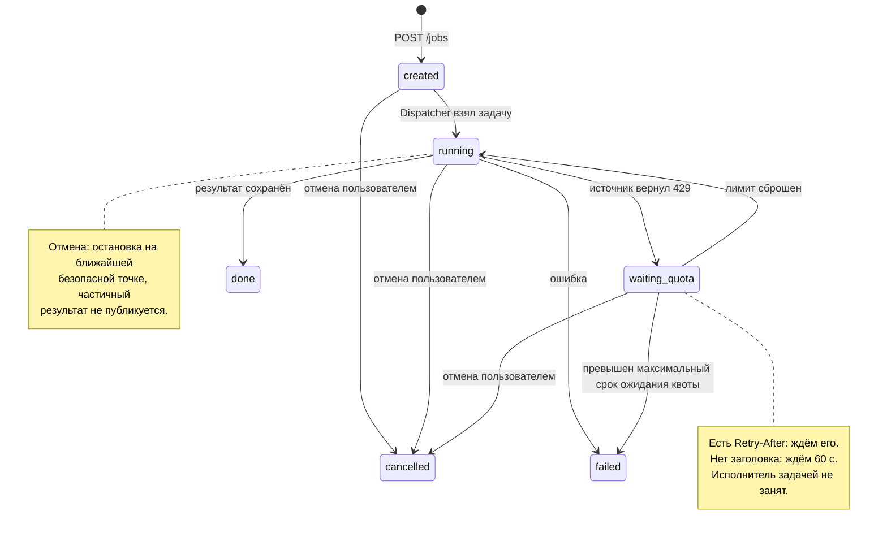

## Сценарии

## REQ-01. Просмотр и выбор матча

**Цель:** найти матч АПЛ для анализа.

**Участник:** пользователь.

**Основной поток:**

1. Пользователь открывает страницу матчей и выбирает диапазон дат.
2. Frontend показывает загрузку и запрашивает список у backend.
3. Backend берёт расписание из своей базы. Если расписания на эти даты в базе нет или оно скачано давно, backend сначала скачивает его из внешнего API и сохраняет в базу.
4. Интерфейс показывает команды, дату, время начала и статус каждого матча.
5. Пользователь выбирает матч и переходит к операциям анализа.

## **Критерии приёмки:**

### 1. Матчи найдены

- **Дано:** за выбранный диапазон есть матчи АПЛ.
- **Когда:** загрузка завершилась.
- **Тогда:** интерфейс показывает соответствующие матчи, команды, время с часовым поясом, статус и время последнего обновления расписания.

### 2. Матчей нет

- **Дано:** матчи отсутствуют.
- **Когда:** получен пустой список.
- **Тогда:** показано сообщение «Матчи не найдены», а не ошибка или бесконечная загрузка.

### 3. Расписание уже есть в базе

- **Дано:** расписание за диапазон обновлялось раньше, чем истёк интервал актуальности.
- **Когда:** пользователь повторно открывает список.
- **Тогда:** backend отвечает из кэша без обращения к источнику.

### 4. Быстрая смена выбора

- **Дано:** пользователь выбрал один матч, затем сразу другой, и ответ по первому пришёл позже.
- **Когда:** страница анализа обновилась.
- **Тогда:** показан последний выбранный матч, данные предыдущего не показываются.

### 5. Прогноз недоступен

- **Дано:** матч уже начался, отменён или время начала неизвестно.
- **Когда:** отображаются операции.
- **Тогда:** запуск прогноза недоступен с пояснением причины; сравнение исторической статистики остаётся доступным.

## REQ-02. Сравнение статистики команд

**Цель:** сравнить исторические результаты команд выбранного матча.

**Участник:** пользователь.

**Основной поток:**

1. Пользователь выбирает матч и нажимает «Сравнить команды».
2. Frontend отправляет запрос с ключом идемпотентности и показывает отправку.
3. Backend проверяет параметры, создаёт Job в `created` и возвращает её идентификатор.
4. Dispatcher берёт Job и через Registry находит исполнителя сравнения.
5. Исполнитель определяет момент отсечения (время начала выбранного матча) и сезоны, нужные по правилам выборки.
6. Для каждого сезона исполнитель проверяет запись о загрузке в БД. Завершённый и полностью загруженный сезон берётся из БД. Отсутствующий сезон, а также текущий сезон, обновлявшийся раньше интервала актуальности, загружается через адаптер источника одним запросом; матчи сохраняются в БД, запись о загрузке обновляется. При сбое или лимите источника действует REQ-06.
7. Исполнитель отбирает из БД сыгранные матчи обеих команд до момента отсечения и рассчитывает показатели.
8. Frontend показывает состояние задачи, затем таблицу сравнения.

## **Критерии приёмки:**

### Сравнение выполнено

- **Дано:** пользователь выбрал матч АПЛ, данных для расчёта достаточно.
- **Когда:** он запустил сравнение и задача завершилась.
- **Тогда:** Job в `done`, для обеих команд показаны число матчей, победы, ничьи, поражения, забитые и пропущенные мячи.

### Расчёт правильный

- **Дано:** набор матчей команды с заранее известным результатом. 
- **Когда:** рассчитаны показатели. 
- **Тогда:** они совпадают с известным результатом, а победы + ничьи + поражения равны числу матчей.

### Без подглядывания в будущее

- **Дано:** пользователь выбрал уже сыгранный матч. В БД есть этот матч и матчи, сыгранные после него.
- **Когда:** исполнитель отбирает матчи для расчёта.
- **Тогда:** выбранный матч и все матчи после него в расчёт не попадают. Используются только матчи, сыгранные до него.

### Сезона нет в базе

- **Дано:** нужного сезона нет в БД.
- **Когда:** исполнитель отбирает матчи для расчёта.
- **Тогда:** сезон загружается через адаптер одним запросом, матчи сохраняются в БД, в записи о загрузке фиксируется время.

### Прошлые сезоны уже в базе

- **Дано:** прошлые сезоны уже скачаны в базу целиком, со всеми матчами всех команд.
- **Когда:** пользователь запускает сравнение любой пары команд, той же, что раньше, или другой.
- **Тогда:** программа считает по данным из базы и не обращается к внешнему API.

### Обновление текущего сезона

- **Дано:** текущий сезон уже загружен.
- **Когда:** исполнитель готовит выборку.
- **Тогда:** если с последней загрузки прошло меньше интервала актуальности, источник не вызывается; иначе сезон обновляется одним запросом.

### Без копий при повторной загрузке

- **Дано:** сезон загружается повторно. 
- **Когда:** матчи сохраняются в БД. 
- **Тогда:** дубликаты не появляются: матч определяется по идентификатору источника, а изменившиеся счёт, статус и дата обновляются.

### Сведения о расчёте

- **Дано:** результат сохранён. 
- **Когда:** пользователь открывает сведения о расчёте. 
- **Тогда:** доступны использованные матчи, источник, момент отсечения и время последнего обновления данных.

### REQ-03. Неверный запрос или изменившийся статус матча — ошибочный сценарий

**Цель:** получить понятный отказ, если анализ запустить невозможно.

**Участник:** пользователь; запрос может поступить из frontend или напрямую в API.

**Основной поток:**

1. Пользователь пытается запустить анализ с неверными параметрами либо прогноз матча, статус которого изменился. Либо приходит запрос на api с некорректными параметрами (статус поменялся)
2. Frontend проверяет выбор матча и операции; backend независимо проверяет параметры.
3. Некорректный запрос отклоняется без создания Job (базовая валидация - матч через год).
4. Для корректного запроса создаётся Job; существование матча, лига и актуальный статус проверяются по источнику при выполнении.
5. При непригодности матча Job завершается в failed, интерфейс показывает причину.

**Критерии приёмки:**

- **Дано:** матч или операция не выбраны. **Когда:** пользователь открывает форму анализа. **Тогда:** кнопка запуска недоступна, интерфейс указывает, что требуется выбрать.
- **Дано:** API получил запрос без обязательных полей или ключа идемпотентности, с неверным форматом или неизвестной операцией. **Когда:** backend проверяет его. **Тогда:** возвращается 422 с указанием ошибочного поля, Job не создаётся.
- **Дано:** источник сообщает, что матч не существует или относится к другой лиге. **Когда:** задача выполняется. **Тогда:** Job переходит в failed с причиной «Матч не найден» или «Лига не поддерживается», интерфейс показывает это сообщение.
- **Дано:** после открытия страницы матч начался, отменён. **Когда:** backend выполняет прогноз. **Тогда:** Job переходит в failed(при отмене) с причиной недоступности прогноза; результат не выдаётся. Для начавшегося по плану - статус матча меняет диспетчер по сигналу поседней проверки job.

## REQ-04. Сбой или лимит источника, недостаточность данных — ошибочный сценарий

**Цель:** избежать неверного результата и бесконечного ожидания при сбое получения данных.

**Участники:** пользователь и внешний источник данных.

**Основной поток:**

1. Backend запрашивает расписание или исторические данные через бд, при отсуствии через адаптер(api).
2. Источник не отвечает, возвращает ошибку, сообщает о превышении лимита запросов или отдаёт некорректные либо недостаточные данные, либо контейнер с бд не доступен (ex. segfault).
3. При временном отказе адаптер выполняет ограниченные повторные попытки с тайм-аутом каждой попытки. При превышении лимита Job ждёт его сброса в состоянии waiting_quota, не занимая исполнителя.
4. Если получить пригодные данные не удалось, backend отдаёт расписание из кэша с отметкой времени обновления, а при отсутствии кэша возвращает ошибку загрузки списка; выполняемая Job завершается в failed.
5. Frontend прекращает показ загрузки и отображает причину и доступное повторное действие.

**Критерии приёмки:**

### 1. Показ кэшированного расписания при недоступном источнике
- **Дано:** источник недоступен, в кэше есть расписание за диапазон.
- **Когда:** пользователь открывает список матчей.
- **Тогда:** показывается сохранённое расписание с временем последнего обновления и пометкой, что данные могут быть неактуальны.

### 2. Ошибка загрузки без кэша; Job не создаётся
- **Дано:** источник недоступен и кэша за диапазон нет.
- **Когда:** backend вернул ошибку.
- **Тогда:** интерфейс показывает ошибку и кнопку повторной загрузки, а не сообщение об отсутствии матчей; Job не создаётся.

### 3. Завершение Job в failed после исчерпания попыток при 5xx/недоступности
- **Дано:** при выполнении Job источник не отвечает или возвращает HTTP 5xx.
- **Когда:** исчерпаны настроенные попытки.
- **Тогда:** Job переходит в failed, интерфейс показывает недоступность данных.

### 4. Продолжение обработки при восстановлении источника до исчерпания попыток
- **Дано:** источник восстановился до исчерпания попыток.
- **Когда:** получены корректные данные.
- **Тогда:** обработка продолжается в той же Job.

### 5. Переход в waiting_quota при HTTP 429 и ожидание сброса лимита
- **Дано:** при выполнении Job источник вернул HTTP 429.
- **Когда:** адаптер получил ответ.
- **Тогда:** Job переходит в waiting_quota; повторный запрос выполняется не раньше сброса лимита — по заголовку ответа источника, а без него не раньше чем через 60 секунд; после возобновления обработка продолжается в той же Job; ответ 429 не расходует попытки, предусмотренные для 5xx.

### 6. Превышение предельного времени ожидания в waiting_quota
- **Дано:** Job в waiting_quota.
- **Когда:** суммарное ожидание превысило настроенный предел.
- **Тогда:** Job переходит в failed с причиной «Превышен лимит запросов к источнику».

### 7. Отбраковка невалидных, неполных или противоречивых данных
- **Дано:** ответ содержит невалидный JSON, отсутствующие обязательные поля, отрицательный счёт или противоречивые записи.
- **Когда:** адаптер проверяет ответ.
- **Тогда:** он не используется для расчёта и не вызывает повторных попыток; выполняемая Job завершается ошибкой данных.

### 8. Ошибка «Недостаточно данных» при нехватке исторических матчей
- **Дано:** пригодных исторических матчей недостаточно по правилам метода (например для точной оценки нужно не менее 10 матчей за всё время существования команды).
- **Когда:** исполнитель проверяет выборку.
- **Тогда:** Job переходит в failed с причиной «Недостаточно данных», отсутствующие значения не заменяются вымышленными.

### 9. Повторный запуск создаёт новую Job с сохранением старой и причины ошибки
- **Дано:** Job завершилась ошибкой.
- **Когда:** пользователь выбирает повторный запуск.
- **Тогда:** создаётся новая Job с новым ключом, старая задача и причина её ошибки сохраняются.

### 10. Ограничение запуска прогноза для начавшегося, отменённого или матча с неизвестным временем начала
- **Дано:** матч уже начался, отменён или время начала неизвестно.
- **Когда:** отображаются операции.
- **Тогда:** запуск прогноза недоступен с пояснением причины; сравнение исторической статистики остаётся доступным.

## Жизненный цикл Job

Состояния:

- `created` — параметры проверены, задача сохранена и ожидает выполнения;
- `running` — исполнитель получает данные и выполняет анализ;
- `waiting_quota` — источник сообщил о превышении лимита запросов, задача ждёт его сброса и не занимает исполнителя;
- `done` — результат успешно сохранён;
- `failed` — выполнение завершилось ошибкой, причина сохранена;
- `cancelled` — задача отменена пользователем, результат не сохраняется.

Разрешённые переходы:

- создание задачи → `created`;
- `created → running` — Dispatcher начинает выполнение;
- `running → waiting_quota` — источник вернул `429`;
- `waiting_quota → running` — наступил момент сброса лимита, Dispatcher возобновляет выполнение;
- `running → done` — результат сохранён;
- `running → failed` — обнаружена ошибка выполнения;
- `waiting_quota → failed` — превышен предел ожидания лимита;
- `created`, `running`, `waiting_quota` → `cancelled` — пользователь отменил задачу.

Запрещённые переходы

Разрешены только переходы со схемы. Всё остальное отклоняется без изменения данных.

| Попытка | Реакция системы |
|---|---|
| Из `done`, `failed`, `cancelled` в любое другое состояние | `InvalidTransition`, данные не меняются. Отмена через API: `409 job_already_finished` |
| `created → done`, `created → failed`, `created → waiting_quota` | `InvalidTransition`: сначала нужен `running` |
| `waiting_quota → done` | `InvalidTransition`: сначала возврат в `running` |
| Любой переход обратно в `created` | `InvalidTransition`: `created` бывает только при создании |
| Повторное `created → running` вторым исполнителем | Условный `UPDATE ... WHERE status='created'` затронул 0 строк, второй исполнитель отступает |

Повторный запуск после `failed` или `cancelled` переходом не является: создаётся новая Job с новым ключом идемпотентности, старая Job и причина её ошибки сохраняются.

Все остальные переходы отклоняются без изменения данных. `done`, `failed` и `cancelled` — конечные состояния. Повторный анализ создаёт новую Job. Начать или возобновить выполнение одной Job может только один исполнитель. Конечное состояние и результат либо причина ошибки сохраняются атомарно. Отмена в `running` выполняется кооперативно: исполнитель проверяет запрос отмены перед каждым обращением к источнику и перед сохранением результата. Повторные попытки при тайм-аутах и `5xx` выполняются внутри `running`, ожидание лимита — в `waiting_quota`. Ошибки загрузки списка и валидации до создания задачи не являются состояниями Job.

## Что предложил ИИ

### Промпт 1

> Мы проектируем веб-сервис аналитики и прогнозирования матчей АПЛ. Пользователь выбирает матч в frontend, запускает сравнение или прогноз, backend создаёт Job, получает исторические данные из внешнего API или бд и сохраняет результат. Frontend показывает состояние и результат. Найди ещё три способа сломать основной сценарий помимо обычного тайм-аута источника и неверного формата запроса. Для каждого приведи пример и проверяемое требование. Учти повторные нажатия, асинхронные ответы и изменение данных. Не предлагай сложное ML, ставки или дополнительные микросервисы.

### Предложения и решения по промпту 1

Решения приняты для этой версии требований и подлежат review команды.

| Предложение ИИ                                         | Пример сбоя                                                              | Решение и причина                                                                                                                                          | Где учтено                          |
| ------------------------------------------------------ | ------------------------------------------------------------------------ | ---------------------------------------------------------------------------------------------------------------------------------------------------------- | ----------------------------------- |
| Двойное нажатие или повтор запроса после потери ответа | Создаются две задачи для одного намеренного запуска                      | Принято: блокировать кнопку при отправке и обеспечивать идемпотентность на backend. Одной блокировки недостаточно при потере ответа                        | REQ-02, общие инженерные требования |
| Поздний ответ подменяет текущий результат              | Пользователь выбрал другой матч, а интерфейс показал прогноз предыдущего | Принято: связывать отображение с матчем, операцией и Job, не применять устаревший ответ к текущему выбору. Это предотвращает неверное прочтение результата | Общие инженерные требования         |
| Матч начался или отменён после открытия страницы       | Frontend ещё предлагает прогноз, хотя матч уже непригоден для него       | Принято: проверять статус на backend при выполнении Job и показывать причину отказа. Проверка только в интерфейсе быстро устаревает                        | REQ-03                              |
